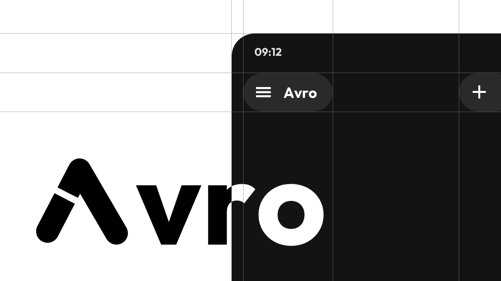

<div align="center">

  

  <br />

  **Autonomous AI Client with Embedded Linux Environment and Zero-Intermediary Execution**

  <br />

  [](LICENSE)
  [](https://developer.android.com)
  [](https://kotlinlang.org/)
  [](https://developer.android.com/jetpack/compose)

  <br />

  [ English ](README.md) · [ العربية ](docs/ar/index.md) · [ 简体中文 ](docs/zh/index.md) · [ 繁體中文 ](docs/zh-Hant/mcp.md)

  <br />

  

</div>

---

## Overview

Avro is a local-first Android client and autonomous AI agent runtime. It connects directly from your device to AI model providers using your own credentials (Bring Your Own Key), bypassing third-party proxy servers.

The application embeds an Alpine Linux sandbox, enabling code execution, system package management, and multi-step tool calls on-device.

---

## Architecture Principles

- **Direct Transport**: All API requests originate on-device and terminate at the official provider endpoints. No telemetric relays or middleman services exist.
- **Embedded PRoot Sandbox**: Runs an Alpine Linux userland natively on Android without root permissions. Supports package installation via apk and execution of Python, shell, and compiled binaries.
- **Bi-directional Layout Engine**: Built with native RTL (Right-to-Left) and LTR support, ensuring natural alignment and typographic hierarchy in Arabic, English, and Asian scripts.
- **Persistent State Control**: Conversations, tools, context memory, and cryptographic secrets remain in encrypted local storage.

---

## Capabilities

### Model Connectivity
- **Native Provider Integrations**: OpenAI, Anthropic Claude, Google Gemini, DeepSeek, Qwen / DashScope, Groq, Ollama, OpenRouter, OpenCode, and local llama.cpp.
- **Custom Protocol Adapters**: Configurable base URLs for OpenAI-compatible, Gemini, and Anthropic proxies.
- **Local GGUF Inference**: On-device model execution and vector embeddings powered by embedded llama.cpp runtime.

### Autonomous Tools and Protocols
- **Linux Terminal Environment**: Isolated container execution with persistent filesystem access and job management.
- **Web Retrieval**: Real-time DuckDuckGo and Brave Search query execution with automatic streaming citation synthesis.
- **Model Context Protocol (MCP)**: Client implementation for connecting remote and local MCP tool servers over SSE and HTTP.
- **Retrieval-Augmented Generation (RAG)**: Semantic vector similarity search over conversation history and stored memories.
- **Background Execution**: Long-running loops, shell background jobs, and scheduled tasks using Android foreground services.

### Interface and Experience
- **Material 3 Monochrome**: High-contrast, typography-focused interface following the Avro-MN design language.
- **Non-Linear Conversation Trees**: Branch, edit, and fork message histories without losing previous alternative responses.
- **Context Budget Accounting**: Real-time token counter with configurable ceiling limits (4K to 1M+ tokens) and non-destructive context compaction.

---

## Repository Structure

```text
├── app/                      # Android application module
│   ├── src/main/java/        # Kotlin source hierarchy (Clean Architecture)
│   │   └── com/newoether/agora/
│   │       ├── api/          # Model provider clients and streaming parsers
│   │       ├── automation/   # Background jobs, shell workers, and tasks
│   │       ├── data/         # Repositories, Room Database, and DataStore
│   │       ├── diagnostics/  # Local telemetry and diagnostics
│   │       ├── mcp/          # Model Context Protocol implementation
│   │       ├── model/        # Domain entities and conversation tree models
│   │       ├── remote/       # Remote server connection and device pairing
│   │       ├── sandbox/      # Alpine Linux PRoot manager and filesystem
│   │       ├── service/      # Foreground service lifecycle controllers
│   │       ├── tool/         # Agent tools (search, memory, file IO)
│   │       ├── ui/           # Jetpack Compose UI components and screens
│   │       ├── util/         # Encoders, tokenizers, and formatters
│   │       ├── viewmodel/    # StateFlow viewmodels
│   │       └── webui/        # Embedded local WebUI server
│   ├── src/main/res/         # UI resources, vector assets, and localization
│   └── src/test/             # Unit and Robolectric JVM test suite
├── avro-brand-kit/           # Brand assets, vectors, tokens, and guidelines
├── docs/                     # Documentation sources (ar, en, zh, zh-Hant)
├── development/              # Architecture specifications and technical RFCs
├── scripts/                  # Automation and build utility scripts
├── server/                   # Optional companion sync services
├── thirdparty/               # PRoot, talloc, and llama.cpp native dependencies
└── build.gradle.kts          # Top-level Gradle Kotlin build configuration
```

---

## Build Instructions

### Prerequisites
- JDK 17 or JDK 21
- Android SDK (API 36 / Android 16 compatible)
- Gradle 9+

### Commands

```bash
# Clone repository
git clone https://github.com/fifikoridek2-boop/Avro.git
cd Avro

# Build Debug APK
gradle assembleDebug

# Execute JVM Tests
gradle :app:testDebugUnitTest
```

---

## Documentation

Comprehensive guides are maintained in the docs directory:
- [System Architecture](ARCHITECTURE.md)
- [Arabic Documentation](docs/ar/index.md)
- [English User Guide](docs/en/index.md)
- [Brand Guide](avro-brand-kit/docs/BRAND-GUIDE.md)
- [Privacy Policy](PRIVACY.md)

---

## License and Provenance

Avro is licensed under the GNU General Public License v3.0 (GPL-3.0) (see LICENSE).
Derived from and compatible with the Agora open-source project by Newo Ether, with customized identity, Arabic bidirectional layout fixes, and brand enhancements.
