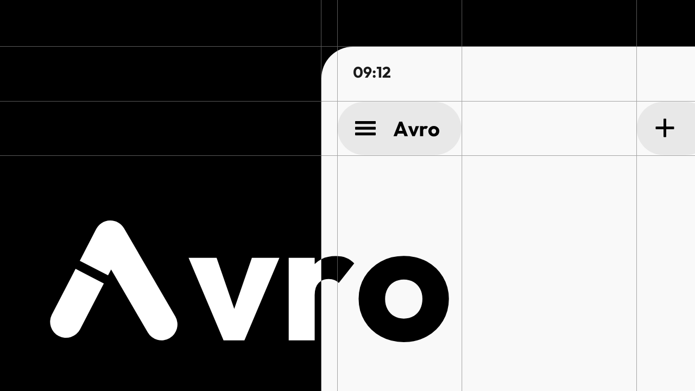

<div align="center">
  

  # Avro

  **High-Performance Autonomous AI Android Client with Native Linux Sandbox, Agentic Tool Execution, and Complete Data Sovereignty.**

  [](LICENSE)
  [](https://developer.android.com)
  [](https://kotlinlang.org/)
  [](https://developer.android.com/jetpack/compose)

  <br />

  

</div>

---

## 🌟 About Avro

**Avro** is a modern, privacy-first Android client and autonomous AI agent platform. It puts you in direct control of your AI models and data sovereignty:
- **No intermediary servers**: Your requests flow directly from your device to your configured AI providers using your own API keys (BYOK - Bring Your Own Key).
- **Embedded Alpine Linux Sandbox**: Execute real Linux shell commands, install packages via `apk add`, and run offline automation scripts directly on your phone using PRoot.
- **Agentic Workflows**: Web search, past-conversation RAG, long-term memory, MCP (Model Context Protocol), local GGUF execution, and background scheduled tasks.
- **Multi-lingual & RTL-first**: Full support for Arabic, English, and 10+ international languages with natural bi-directional layout adaptations.

---

## 🚀 Key Features

### 🧠 Model Providers & Multi-LLM Access
- **10+ Native Providers**: OpenAI, Anthropic Claude, Google Gemini, DeepSeek, Qwen / DashScope, Groq, Ollama, OpenRouter, OpenCode, and local llama.cpp.
- **Custom Endpoints**: Connect to any OpenAI-compatible, Google Gemini, or Anthropic-compatible self-hosted or reverse-proxy endpoint.
- **Local GGUF Runtime**: Run quantized models completely offline on your device using embedded `llama.cpp` and local embedding models.

### 🛠️ Agentic Tools & Autonomous Capabilities
- **Integrated Linux Terminal**: Real Alpine Linux mini-rootfs with package management (`apk add python3 git curl...`) powered by PRoot.
- **Web Search & Retrieval**: Built-in DuckDuckGo and Brave Search integrations with automatic streaming citation extraction.
- **Long-term Memory & Context RAG**: Semantic similarity search and memory storage across your historical conversations.
- **Model Context Protocol (MCP)**: Connect to external MCP tools and servers over HTTP and SSE.
- **Background Tasks & Autonomous Loops**: Automated agent execution loops and scheduled notifications.

### 🎨 Design & Visual Identity
- **Material 3 Design**: Dynamic M3 color palette, smooth spatial transitions, customizable typography, and full dark/light theme support.
- **Brand Identity**: Complete brand assets and guidelines located in [`avro-brand-kit/`](avro-brand-kit/).
- **Tree-Structured Conversations**: Branching chat trees allow editing previous prompts without losing alternative generation branches.
- **Context Budgeting**: Granular context window management (4K to 1M+ tokens) with smart compaction and thinking-tag streaming.

---

## 📂 Project Structure

```text
├── app/                      # Android Application module
│   ├── src/main/java/        # Full Kotlin source tree (MVVM / Clean Architecture)
│   │   └── com/newoether/agora/
│   │       ├── api/          # LLM Providers (OpenAI, Gemini, Claude, Ollama, DeepSeek)
│   │       ├── automation/   # Background jobs, shell workers, tasks
│   │       ├── data/         # Repositories, Room Database, DataStore, encryption
│   │       ├── diagnostics/  # Diagnostics and telemetry
│   │       ├── mcp/          # Model Context Protocol client
│   │       ├── model/        # Domain entities, conversation state, message trees
│   │       ├── remote/       # Remote server connection and device pairing
│   │       ├── sandbox/      # Alpine Linux sandbox & PRoot engine
│   │       ├── service/      # Foreground services and background execution
│   │       ├── tool/         # Agentic tools (web search, memory, file ops)
│   │       ├── ui/           # Jetpack Compose UI (Chat, Settings, Components, Motion)
│   │       ├── util/         # Tokens, parsers, formatters, localization
│   │       ├── viewmodel/    # StateFlow viewmodels
│   │       └── webui/        # Embedded local WebUI server
│   ├── src/main/res/         # Resources, drawables, fonts, multi-language strings
│   └── src/test/             # Unit and Robolectric JVM test suite
├── avro-brand-kit/           # Complete Brand Kit (Logos, SVGs, Videos, Tokens, Guidelines)
├── docs/                     # Full Documentation site (Markdown for MkDocs)
├── development/              # Architecture specifications and technical RFCs
├── scripts/                  # Development scripts (Python, PowerShell)
├── server/                   # Optional sync and companion server scripts
├── thirdparty/               # PRoot, talloc, and llama.cpp native references
└── build.gradle.kts          # Top-level Gradle Kotlin DSL build configuration
```

---

## 🛠️ Building & Running

### Requirements
- **JDK 17 or JDK 21**
- **Android SDK** (API Level 36 / Android 16 compatible)
- **Gradle 9+**

### Build Commands

```bash
# Clone the repository
git clone https://github.com/fifikoridek2-boop/Avro.git
cd Avro

# Assemble Debug APK
gradle assembleDebug

# Run Unit & Robolectric Tests
gradle :app:testDebugUnitTest
```

---

## 📖 Documentation & Architecture

Full documentation is available in the [`docs/`](docs/) directory and [`development/`](development/):
- **[Architecture Deep-Dive](ARCHITECTURE.md)**: System design, data flow, and security boundaries.
- **[User Guide & Manual](docs/en/)**: Comprehensive feature guides, configuration, and tips.
- **[Brand Guide](avro-brand-kit/docs/BRAND-GUIDE.md)**: Color tokens, logo usage, and typography rules.
- **[Privacy Policy](PRIVACY.md)**: Local-first security and data handling policies.

---

## 📄 License & Attribution

Avro is licensed under the **GNU General Public License v3.0 (GPL-3.0)** ([LICENSE](LICENSE)).  
Derived from and compatible with the Agora open-source project by Newo Ether, with customized brand identity and enhancements.
